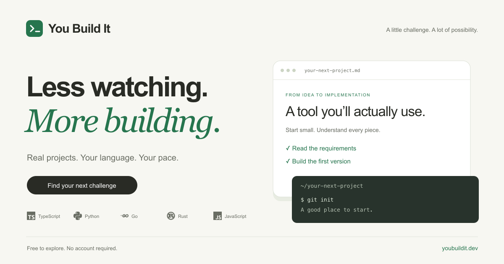

#  You Build It

Learn by building real applications. Explore free coding challenges, implement them in your own language, and compare available reference solutions. No account required.

[](https://github.com/youbuildit/youbuildit.dev/actions/workflows/test.yml)
[](https://github.com/youbuildit/youbuildit.dev/releases)
[](https://nextjs.org)
[](https://www.typescriptlang.org)
[](https://bun.sh)
[](https://flox.dev)
[](LICENSE)

[](https://youbuildit.dev)

[Explore challenges](https://youbuildit.dev/challenges) · [Documentation](docs/README.md) · [Contribute](docs/contributing.md)

## Run locally

```bash
flox activate
bun install --frozen-lockfile
cp .env.example .env.local
# Set a development PRISMA_DATABASE_URL in .env.local.
bun run dev --hostname 127.0.0.1 --port 4317
```

Next.js, React, and TypeScript power the interface; Prisma Accelerate connects challenge content to PostgreSQL. Documentation lives in `docs/` and also renders at `/docs`.

See [local development](docs/local-development.md) for configuration, [architecture](docs/architecture.md) for diagrams, and [the API reference](docs/api.md) for public endpoints.

## Quality and releases

`bun run check` runs formatting, lint, types, Markdown/Mermaid validation, the LOC budget, and tests. `bun run verify` also builds production. Git hooks mirror CI; successful main builds produce automatic patch releases.

Licensed under [PolyForm Shield](LICENSE).
