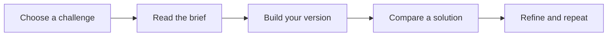
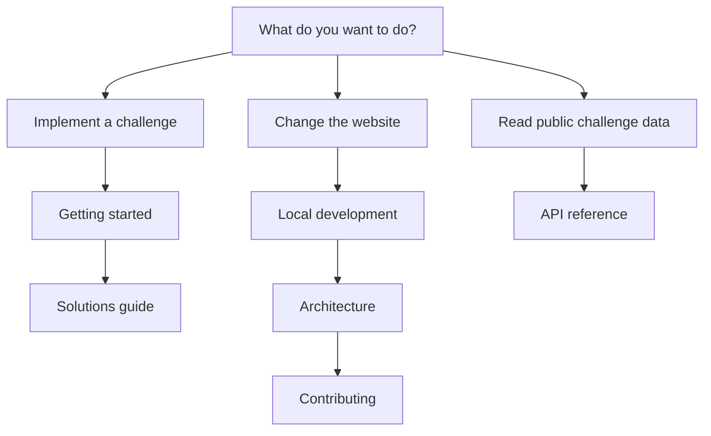

# Overview

You Build It is a collection of practical coding challenges. Every published challenge is free to read, and available solutions are free to explore. You do not need an account.

## Learn by building

Choose a project, read its requirements, and implement it in your own environment. The goal is working software and a clearer understanding of how it works. Use the language and tools that fit the challenge.

## Find your starting point

- [Getting started](getting-started.md): pick a challenge and plan your first build.
- [Solutions](solutions.md): compare implementations and download available code.
- [Local development](local-development.md): run the platform with Flox and Bun.
- [Architecture](architecture.md): understand the application and data flow.
- [API reference](api.md): read the public challenge endpoints.
- [Contributing](contributing.md): run the checks and propose an improvement.
- [Troubleshooting](troubleshooting.md): recover from common problems.

## Built in the open

The platform uses Next.js, React, TypeScript, and PostgreSQL through Prisma. Challenge content comes from the database; these documentation pages come from the repository's `docs/` directory.

Browse [the challenge library](https://youbuildit.dev/challenges) or read [the source](https://github.com/youbuildit/youbuildit.dev). The repository's [license](../LICENSE) describes permitted use.

## What the platform provides

Each challenge is a project brief: an explanation of what to build, the skills involved, and requirements to work through. The library groups projects by category and difficulty, with search to help you find a topic that interests you. Estimated times help you plan a session, but they are not deadlines.

Some challenges also provide reference files, implementation notes, and downloadable source archives. A reference is another approach to study, not a requirement to use its language or copy its design. A challenge remains useful even when no reference is attached.

The website does not host an execution sandbox or automatically grade submissions. You build and test in your own environment. This keeps the workflow flexible: use a familiar language to explore a new concept, or use a small project to practice a new language.

## Choose the right guide

There are two separate workflows in these docs. Solving a challenge does not require installing the You Build It platform. Running the platform is for changing its interface, documentation, APIs, or content handling.

If you are browsing for the first time, open a beginner challenge and read its entire brief before deciding how to build it. If you already have an implementation, use the solutions guide to compare behaviors and trade-offs. If you are debugging the website locally, the troubleshooting guide explains the distinction between an empty database and a failed connection.

## Reading examples and diagrams

Command examples are shown in fenced code blocks. Run them from the directory and environment described in the surrounding instructions. Example API payloads are illustrative; use the live response when building an integration.

Mermaid diagrams summarize workflows and data relationships. Each rendered diagram includes an expandable source view so you can inspect its steps as text. The same Markdown files can be read directly in the repository without maintaining a second set of documentation.

## Navigate and reuse the guides

Use Search docs or Cmd+K (Ctrl+K on other platforms) while reading documentation to find a guide by title. On mobile, the menu button opens the documentation drawer; On this page expands the current guide’s section links.

Each code block includes its language, line numbers, and a Copy button that copies only the code. Page actions let you copy the guide as Markdown, edit its source on GitHub, return to the top, or open a chat provider with a link to the guide.
