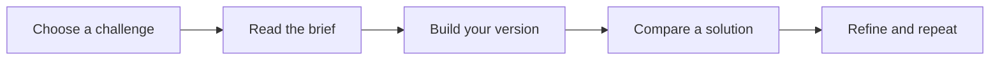

# Overview

You Build It is a collection of practical coding challenges. Every published challenge is free to read, and available solutions are free to explore. You do not need an account.

## Learn by building

Choose a project, read its requirements, and implement it in your own environment. The goal is working software and a clearer understanding of how it works. Use the language and tools that fit the challenge.

## Find your starting point

- [Getting started](getting-started.md): pick a challenge and plan your first build.
- [Solutions](solutions.md): compare implementations and download available code.
- [Local development](local-development.md): run the platform with Flox and Bun.
- [Architecture](architecture.md): understand the application and data flow.
- [API reference](api.md): read the public challenge endpoints.
- [Contributing](contributing.md): run the checks and propose an improvement.
- [Troubleshooting](troubleshooting.md): recover from common problems.

## Built in the open

The platform uses Next.js, React, TypeScript, and PostgreSQL through Prisma Accelerate. Challenge content comes from the database; these documentation pages come from the repository's `docs/` directory.

Browse [the challenge library](https://youbuildit.dev/challenges) or read [the source](https://github.com/youbuildit/youbuildit.dev). The repository's [license](../LICENSE) describes permitted use.
