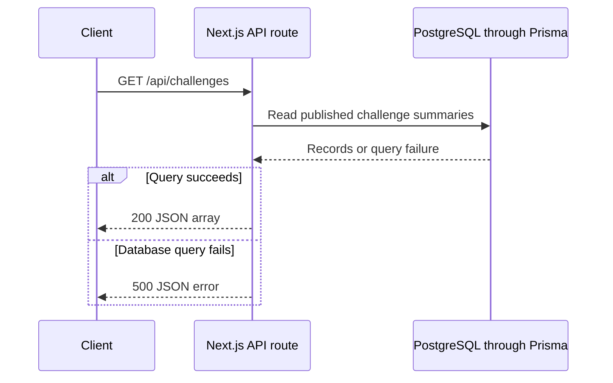

# API reference

These read-only endpoints power the public website. No account is required. Use the origin of your website instance: `https://youbuildit.dev` for the public site or `http://127.0.0.1:4317` for a local development server.

These are application endpoints rather than a separately versioned API. Handle non-success responses, tolerate additional fields, and avoid frequent polling. Cross-origin browser access is not a documented contract; the frontend examples below assume a request from the same origin.

## Request and response flow



## List challenges

`GET /api/challenges`

Returns an array containing published challenge summaries. A successful empty result is `[]`. The current implementation returns the full list rather than paginated results; the website applies search and filters in the browser.

```bash
curl --fail --show-error https://youbuildit.dev/api/challenges
```

The following is an illustrative summary for the word-counter project. Content, skills, timing, and solution availability can change:

```json
[
  {
    "slug": "build-your-own-wc-tool",
    "title": "Build Your Own wc Tool",
    "summary": "Create a command-line word counter.",
    "difficulty": "Beginner",
    "category": "Command Line",
    "skills": ["File I/O", "Text Processing"],
    "estimatedTime": "2-4 hours",
    "hasSolution": true,
    "solutionLanguage": "python"
  }
]
```

| Field                | Meaning                                                         |
| -------------------- | --------------------------------------------------------------- |
| `slug`               | Identifier used in challenge pages and solution endpoints       |
| `title`, `summary`   | Human-readable project description                              |
| `difficulty`         | Display value such as `Beginner`, `Intermediate`, or `Advanced` |
| `category`, `skills` | Category and skill labels used by the library                   |
| `estimatedTime`      | Editorial time estimate, not a duration guarantee               |
| `hasSolution`        | Whether the challenge advertises a reference implementation     |
| `solutionLanguage`   | Optional language label; may be absent                          |

The list does not contain the full challenge brief. Open `/challenge/{slug}` to read the project requirements.

## Pick a random challenge

`GET /api/challenges/random`

Returns one published challenge summary with `slug`, `title`, `summary`, `difficulty`, `category`, `skills`, and `estimatedTime`. Unlike the list endpoint, its response does not include solution availability fields. An empty library returns `404` with an error message.

```javascript
async function chooseChallenge() {
  const response = await fetch('/api/challenges/random');
  if (!response.ok) {
    throw new Error(`Could not choose a challenge (${response.status})`);
  }
  const challenge = await response.json();
  window.location.assign(`/challenge/${encodeURIComponent(challenge.slug)}`);
}
```

Call this function from an explicit user action. Handle its rejected promise in your interface by showing a useful error and a retry action, rather than navigating to an undefined slug.

## Read a solution

`GET /api/challenges/{slug}/solution`

Returns solution files and supporting metadata for a published challenge. The response contains `language`, a `files` array, and a `metadata` object. Each file includes its `type`, `filename`, `relativePath`, and `content` as text.

```json
{
  "language": "python",
  "files": [
    {
      "type": "SOURCE",
      "filename": "counter.py",
      "relativePath": "src/counter.py",
      "content": "def count_words(text):\n    return len(text.split())\n"
    }
  ],
  "metadata": {
    "linesOfCode": 3,
    "testCoverage": 0,
    "keyFeatures": [],
    "implementationNotes": []
  }
}
```

This is an example payload, not a promise that a published challenge contains those exact files. File types include `SOURCE`, `TEST`, `CONFIG`, `README`, and `FIXTURE`. Treat content as source text, not trusted executable instructions for your application.

Metadata can fall back to values calculated from stored files. In particular, a coverage value may be an estimate when measured metadata is absent; it is not evidence of a test run in your environment. Run the downloaded test suite to establish its actual behavior.

A missing or unpublished challenge returns `404`. A challenge that exists but has no available solution files also returns `404`, with a different error message. See [Solutions](solutions.md) for how readers use this data.

## Download solution files

`GET /api/challenges/{slug}/solution/download`

Returns a ZIP attachment when the published challenge has solution files. Save a successful response as a file rather than parsing it as JSON. Replace the slug below if that project no longer offers a solution:

```bash
curl --fail --show-error --output solution.zip \
  https://youbuildit.dev/api/challenges/build-your-own-wc-tool/solution/download
unzip -l solution.zip
```

`unzip -l` lists the contents without extracting them. Extract into a new directory, read the included setup instructions, and install dependencies separately from other projects. The archive preserves the solution's relative file paths.

## Handle errors

| Status | Interpretation                                                           | Suggested response                                |
| ------ | ------------------------------------------------------------------------ | ------------------------------------------------- |
| `200`  | The request succeeded                                                    | Read the expected JSON or ZIP payload             |
| `404`  | No matching published content, no solution, or an empty random selection | Explain that the requested content is unavailable |
| `500`  | The server could not complete the request                                | Offer a retry and report persistent failures      |

Check `response.ok` before using the body. Network failures can reject `fetch` before an HTTP response exists, so handle those separately from a `404` or `500`. Do not expose raw server diagnostics or connection details to readers.

For a bug report, include the endpoint, status, approximate time, and reproducible steps. Avoid attaching credentials or a complete environment file. The [troubleshooting guide](troubleshooting.md) explains how to distinguish missing data from a local connection problem.
