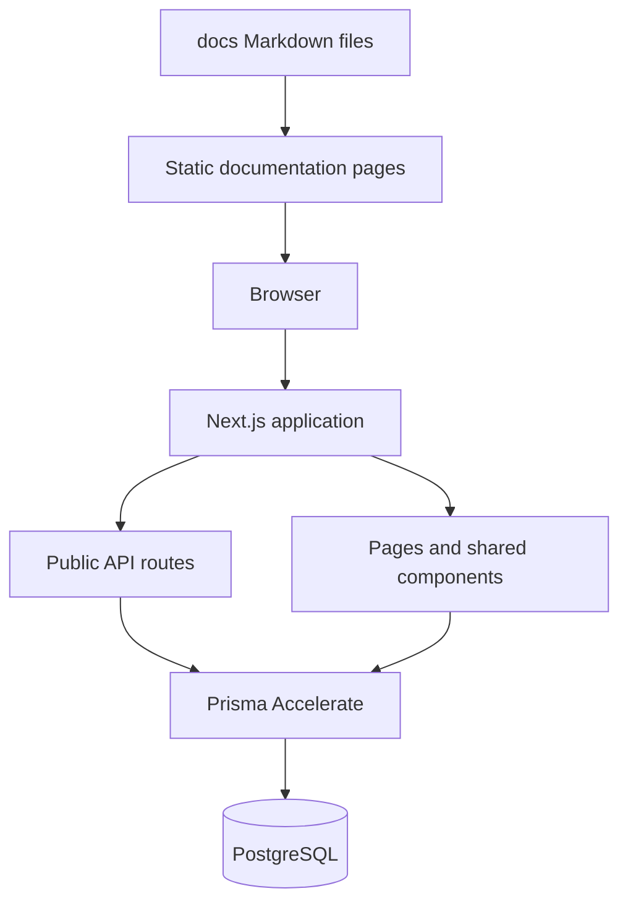
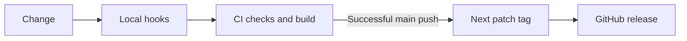

# Architecture

The application uses the Next.js App Router. React components render the interface, server routes serve public data, and Prisma reads PostgreSQL directly through its driver adapter or through Accelerate.

## Request flow

Challenge metadata, Markdown content, solutions, and solution files are stored in the database. Published records are exposed to readers. Documentation is versioned with the application in `docs/` and rendered through one shared layout.

## Source map

| Directory     | Responsibility                                              |
| ------------- | ----------------------------------------------------------- |
| `app/`        | Routes, metadata, API handlers, and page composition        |
| `components/` | Shared navigation, challenge UI, and content rendering      |
| `hooks/`      | Browser data fetching and interaction state                 |
| `lib/`        | Database client, documentation loader, and shared utilities |
| `prisma/`     | Schema and versioned database migrations                    |
| `docs/`       | User and contributor documentation                          |
| `scripts/`    | Documentation and source budget checks                      |
| `.flox/`      | Locked development environment                              |

## Delivery flow

The release workflow tags the exact successful CI revision, not an untested newer commit. Production database migrations run separately when migration files change. Vercel remains the application host; a GitHub release is a source release, not proof of deployment.
