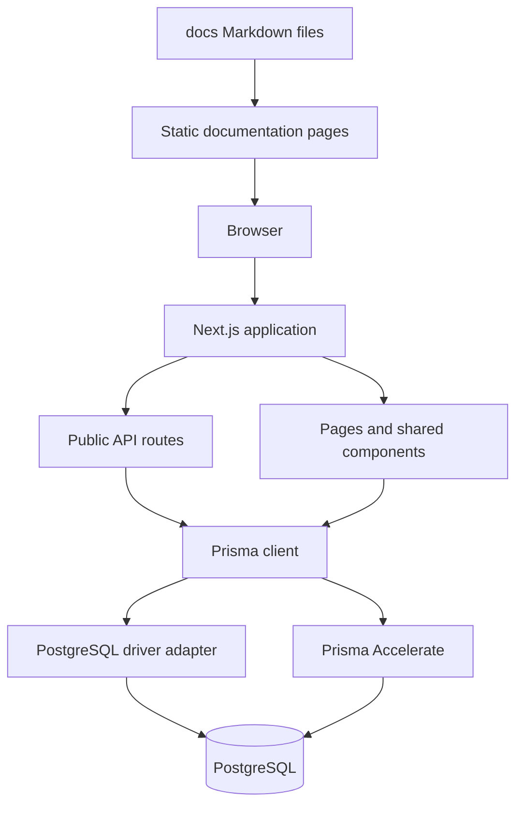
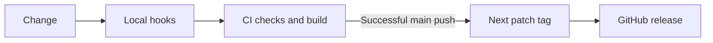
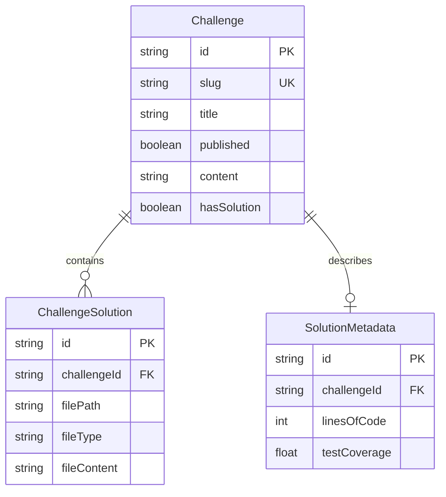
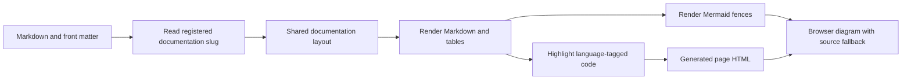

# Architecture

The application uses the Next.js App Router. React components render the interface, server routes serve public data, and Prisma reads PostgreSQL directly through its driver adapter or through Accelerate.

## Request flow

Challenge metadata, Markdown content, solutions, and solution files are stored in the database. Published records are exposed to readers. Documentation is versioned with the application in `docs/` and rendered through one shared layout.

## Source map

| Directory     | Responsibility                                              |
| ------------- | ----------------------------------------------------------- |
| `app/`        | Routes, metadata, API handlers, and page composition        |
| `components/` | Shared navigation, challenge UI, and content rendering      |
| `hooks/`      | Browser data fetching and interaction state                 |
| `lib/`        | Database client, documentation loader, and shared utilities |
| `prisma/`     | Schema and versioned database migrations                    |
| `docs/`       | User and contributor documentation                          |
| `scripts/`    | Documentation and source budget checks                      |
| `.flox/`      | Locked development environment                              |

## Delivery flow

The release workflow tags the exact successful CI revision, not an untested newer commit. Production database migrations run separately when migration files change. Vercel remains the application host; a GitHub release is a source release, not proof of deployment.

## Brand palette

You Build It pairs forest green (`#26754e`) with warm paper (`#f7f7f2`),
charcoal (`#292b25`), and pale sage. The terminal logo uses the same forest
green with a white prompt. Keep the mark's shape when creating new assets.

UI accents and the inline logo inherit `--brand` from `styles/base.css`.
Standalone SVGs, browser icons, and social images use the same literal palette.
When changing it, update `public/logo.svg`, `public/icons/`, `app/icon.svg`,
`public/og.svg`, and the dynamic OG route together; regenerate PNG/ICO assets
from their SVG sources.

## Challenge data model

A `Challenge` is the central record. It contains the public metadata, full Markdown brief, publication state, and solution-availability fields. A challenge can have many solution files and at most one solution-metadata record.

The diagram shows the main relationships, not every schema field. File paths are unique within a challenge, so a solution can contain `src/main.py` and `tests/main.py` without treating them as the same file. Publication controls which challenges the public routes return.

The list endpoint selects summary fields instead of returning the complete brief and every solution file. The solution endpoint loads the associated files when requested. Keeping these operations separate avoids sending source archives to readers who are only browsing the library.

## Database connections

`lib/prisma.ts` constructs the client from `PRISMA_DATABASE_URL`. A direct PostgreSQL URL uses the PostgreSQL driver adapter; a Prisma URL uses Accelerate. Development reuses the client across module reloads to avoid creating a fresh connection client for each reload.

The Prisma CLI has its own configuration in `prisma.config.ts`. It reads the process environment so client generation can run without requiring a database connection, while migration commands still require a configured URL. This is why the local-development guide explicitly exports the development URL before applying migrations.

Versioned migrations describe schema changes. They are distinct from content records and from the browser-test fixture. A successful migration proves the schema was updated, not that the production catalog was imported.

## Documentation rendering

Documentation has one source of truth: the Markdown files under `docs/`. `lib/docs.ts` reads front matter, resolves the allowed slugs, extracts second-level headings for navigation, and removes the first Markdown heading because the page layout supplies its own title.

The syntax-highlighting plugin transforms code during page generation. It does not add an interactive editor or execute the examples. Mermaid is handled separately by a client component that loads the renderer, uses strict security settings, and offers the original source when visual rendering is unavailable.

The slug allowlist prevents arbitrary filesystem paths from becoming documentation routes. Adding a new page requires both its Markdown file and an entry in `docSlugs`; changing an existing page does not require a second content copy.

## Browser interactions

Global navigation, the mobile menu, and quick search are shared across the site. Search loads its interface on demand and fetches challenge summaries when opened. The input manages the active result through combobox/listbox semantics; pointer and keyboard navigation update the same selected row.

The dialog locks the document's scrolling while open and restores focus when closed. Its result list is the scrolling region, which keeps the search field and footer available. These behaviors are covered by browser checks alongside mobile navigation, documentation rendering, and solution downloads.

## Validation and delivery boundaries

A local commit runs the shared repository checks. A push additionally verifies a production build and browser journeys against an isolated database. CI repeats those checks in the committed Flox environment, so a release is based on a revision whose source and browser behavior were both tested.

Database migrations run in their own workflow when schema or migration paths change on `main`. The automatic release workflow waits for successful CI, verifies that the event belongs to the same repository, and tags that tested commit. It does not publish a package or certify a hosting deployment.

The content-trigger workflow can request a hosting rebuild when its deploy hook is configured. Repository releases, database changes, and hosting deployments are separate operations with separate evidence of success.
