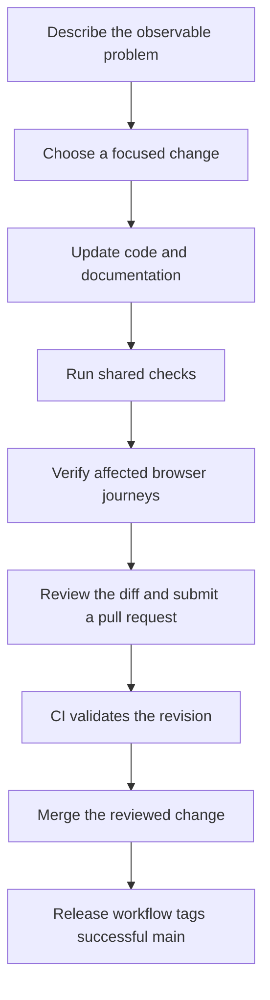

# Contributing

Start with [Local development](local-development.md). Use a branch for your change and keep the scope focused. Describe the behavior before and after the change in your pull request.

## Run the shared checks

```bash
bun run check
bun run build
```

The pre-commit hook uses the same `check` command as CI. Pre-push runs `verify:browser`: it creates a disposable PostgreSQL database, applies migrations, builds production, and runs browser checks. Installation enables the hooks through Husky. Formatting failures can be repaired with `bun run format`; review the resulting diff before committing.

CI uses the committed Flox environment and frozen Bun lockfile. It runs formatting, ESLint, TypeScript, Markdown/link validation, Mermaid parsing and browser rendering, the line budget, tests, and a production build. Browser tests use an isolated PostgreSQL service and a clearly labeled fixture, including solution and ZIP checks. Inside Flox, run `bunx playwright install chromium` once, then `bun run verify:browser`. This provisions a temporary PostgreSQL cluster on port 55438 and stops it afterward. Set `TEST_DATABASE_URL` to reuse a dedicated `youbuildit_test` database. The seed refuses other database names.

Dependabot proposes weekly dependency and Actions updates.

## Keep code lean

`scripts/loc-budget.json` records the repository's baseline authored source line count and existing oversized files. The total cannot grow past the baseline, and new source files must stay at or below 350 lines. Existing oversized files may shrink but cannot grow beyond their recorded ceiling.

Prefer deleting duplicate UI and sharing content over compressing readable code. Comments should explain decisions rather than narrate syntax. Changes to the budget require an explicit rationale in review.

## Update documentation

Edit the relevant Markdown page in `docs/`, with a title, description, and group in its front matter. Use relative `.md` links between pages; the website converts them to `/docs` routes. Use fenced `mermaid` blocks for diagrams. CI checks Markdown, local links, and diagram syntax.

## Commit and release

Use conventional commit prefixes such as `feat:`, `fix:`, `docs:`, or `ci:`. Keep the subject within 72 characters. Do not commit secrets or environment files.

A successful CI run for a push to `main` triggers an automatic patch tag and a GitHub release with generated notes. The automation checks out the tested SHA and skips revisions that already have a release tag. Re-running it is safe. No package is published.

## Report a problem

Open [an issue](https://github.com/youbuildit/youbuildit.dev/issues) with the route, reproduction steps, expected result, and observed behavior. Challenge ideas and content corrections are welcome; include the challenge URL when relevant.

## Plan a focused change

Before editing, identify the reader or developer workflow you want to improve. For example, “keyboard search should keep its selected result visible” is easier to implement and verify than “improve search.” Write down the current behavior, the desired behavior, and one way to demonstrate the difference.

Inspect the existing implementation and reuse its components and design tokens. For UI changes, check narrow and wide layouts, keyboard access, and empty or error states. For data changes, distinguish schema updates from content updates and work against a development database.



## Choose the right validation

| Change                              | Useful local checks                                                            |
| ----------------------------------- | ------------------------------------------------------------------------------ |
| Wording or documentation links      | `bun run docs:check` and a rendered-page review                                |
| Mermaid diagrams                    | `bun run docs:check` plus browser rendering                                    |
| Component behavior or styling       | Shared checks, affected browser journeys, and responsive review                |
| API or database behavior            | Unit tests, migrations in a disposable database, and relevant browser journeys |
| Dependencies or build configuration | Frozen install, shared checks, production build, and browser verification      |

The hooks still run their configured checks before a commit or push. Use targeted checks while iterating to find a problem quickly, then let the complete checks verify the final revision. A passing formatter cannot tell you whether a navigation control works, and a passing unit test does not prove a layout fits a phone.

If a check fails, read its first meaningful error before rerunning it. Formatting problems, type errors, missing environment variables, and browser assertion failures need different fixes. Report checks you could not run and the specific reason.

## Author documentation examples

Use a second-level heading for each topic that should appear in the page's table of contents. Keep heading names descriptive and unique within the page. Use relative links such as `solutions.md` so the repository and website share the same content structure.

A page starts with front matter:

```yaml
title: Example guide
description: Explain the outcome a reader can achieve with this guide.
group: Guides
```

Use fenced blocks with an explicit language, such as `bash`, `python`, `javascript`, `typescript`, `json`, or `yaml`, for syntax highlighting. Use `text` for output that should remain plain. Use `mermaid` for diagrams; do not wrap a Mermaid diagram in a JavaScript fence.

Introduce each runnable command with its working directory, prerequisites, and expected result. Label sample payloads and partial implementations as examples. Do not use real tokens, connection strings, or private data in sample output.

When adding a new page, register its slug in `lib/docs.ts` and link it from the overview. Check that the title, sidebar entry, heading anchors, code blocks, and diagrams render together. Existing pages only need their Markdown updated.

## Review the final diff

Before submitting, inspect `git diff` for accidental formatting churn, generated artifacts, fixture data, and local configuration. The line budget is intended to keep the implementation maintainable, not to encourage unreadable one-line code. Prefer removing duplication or an unnecessary abstraction to raising the limit.

A useful pull-request description explains the concrete trigger, the changed behavior, and the checks performed. Include screenshots when they help a reviewer assess a visual change, but also explain the behavior in text. If you changed a response shape or a setup command, update the corresponding guide in the same change.

When working from a fork, check which repository owns the base branch before submitting a pull request. Keep your feature work on a branch and do not force-push a shared `main`. A successful workflow on a fork does not automatically prove that the original repository has received the change.

## Understand the release result

After a change reaches `main`, wait for CI on that exact revision. The release workflow creates the next patch tag or reuses an existing release tag on that commit. Its GitHub release contains generated notes; it does not upload a package to a registry.

If release automation fails after CI succeeds, inspect the release job rather than changing application code to manufacture another release. A hosting deployment or database migration may have its own status and should be checked separately when it is part of the change.
