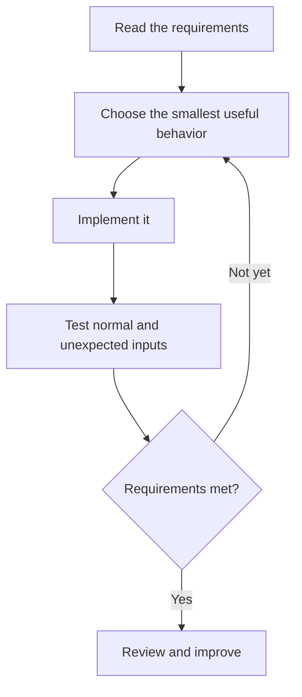

# Getting started

You only need a browser to explore the library. To implement a challenge, use an editor and the tools for your chosen programming language. Running this website locally is optional.

## Choose a challenge

Open [Challenges](https://youbuildit.dev/challenges). Use the search and filters to narrow the library by difficulty, category, or skills. If you are new to a topic, start with a beginner challenge and a small first milestone.

Read the summary, expected skills, and estimated time. Time estimates are guidance, not deadlines. Clear the filters if no results match.

## Turn the brief into a plan

Read the complete challenge before coding. Write down its inputs, outputs, and constraints. Split the requirements into small steps you can verify independently.

## Build and verify

Create a directory or repository for your implementation. Start with one working path before adding options or polishing the interface. Save incremental commits and test malformed, empty, and boundary inputs as well as the happy path.

The website does not execute or grade your implementation. Keep your code locally or in your own repository, and use your language's test tools to verify it.

## Learn from another approach

When a challenge includes a solution, compare it after making your own attempt. Focus on decisions and trade-offs rather than reproducing every line. See [Solutions](solutions.md) for viewing and downloading code.
