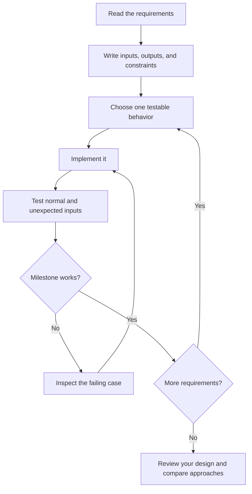

# Getting started

You only need a browser to explore You Build It. To implement a challenge, use an editor and the tools for your chosen programming language. You do not need to run this website, create an account, or use the same language as a reference solution.

The platform gives you a project brief and, for some challenges, an implementation to study. Your code stays in your own directory or repository. The site does not execute submissions, grade your work, or track completion for you.

## Choose a challenge

Open the [challenge library](https://youbuildit.dev/challenges). Search by title, description, or skill, then narrow the results with the category and difficulty filters. The homepage also offers difficulty-based entry points and a small selection of projects.

| If you want to…                                       | A useful starting point                                |
| ----------------------------------------------------- | ------------------------------------------------------ |
| Practice reading input and transforming text          | A beginner command-line tool, such as a word counter   |
| Understand structured data                            | A parser challenge, such as JSON or CSV                |
| Learn how applications communicate                    | A networking or web-development challenge              |
| Explore implementation details beneath familiar tools | A database, compiler, or systems-programming challenge |

Read the estimated time as a rough planning aid. A topic that is new to you may take longer, and that is fine. Difficulty describes the scope of a project; it is not a judgment of your ability.

If the library looks empty, clear the search and filters before choosing a different project. You can share a filtered library URL with someone else.

## Use quick search

Select Search in the navigation or press **Cmd+K** on macOS or **Ctrl+K** on other platforms. Start typing a tool or skill. Use the up and down arrow keys to change the selected result, then press Enter to open it. Escape closes the dialog and returns focus to where you started.

Use Everything, Beginner, Intermediate, or Advanced to narrow quick-search results by difficulty. The footer shows the matching result count; All challenges opens the full library.

The highlighted row is the current selection. Moving the pointer over another result selects that row. Results scroll independently of the underlying page, and the search field remains available while you browse them.

## Turn the brief into a plan

Read the full brief before opening an editor. Write down what your program receives, what it should produce, and what makes an input invalid. Separate required behavior from improvements you might explore later.

For a word counter, a first milestone might be “count the words in one string.” Reading files, handling command-line flags, and reproducing another tool's output can follow. A milestone should be small enough that you can describe how you will check it before implementing it.



## Build a small first version

Create a directory for your implementation. This is separate from the repository that runs the You Build It website:

```bash
mkdir my-word-counter
cd my-word-counter
git init
```

Here is a deliberately small Python example. It demonstrates one behavior rather than a complete implementation of the word-counter challenge. Save it as `counter.py`:

```python
def count_words(text: str) -> int:
    return len(text.split())


assert count_words("") == 0
assert count_words("hello world") == 2
assert count_words("  one\n two\tthree  ") == 3
```

Run `python3 counter.py` in an environment with Python installed. The script produces no output when the assertions pass. If an assertion fails, Python reports which check did not match. Python is an example language here; the website's Flox environment does not install every language you might use for a challenge.

Next, extend the implementation according to the actual brief. For example, keep the word-counting function separate from code that reads a file so that input handling and counting can be tested independently.

## Verify behavior deliberately

Do not stop after one successful run. Make a short checklist of normal, empty, malformed, and boundary inputs. For a tool that processes text, consider repeated whitespace, multiple lines, missing files, and non-ASCII characters where the brief requires them.

| Check                            | What it helps you discover                     |
| -------------------------------- | ---------------------------------------------- |
| Small, ordinary input            | Whether the core behavior works                |
| Empty input                      | Accidental assumptions that data always exists |
| Invalid options or missing files | Whether failures are understandable            |
| Large input                      | Whether the approach scales as expected        |
| Repeated runs                    | Hidden state or nondeterministic behavior      |

Compare against an existing tool only when the brief asks for compatible behavior. A shell command's output format, exit status, and treatment of errors can matter just as much as the computed value.

Save a commit after a milestone works. Describe the behavior you added, then move on to the next requirement. If you get stuck, reduce the problem to the smallest input that reproduces it.

## Review and continue

Before calling the project complete, run your checks from a fresh terminal and write down the setup and usage commands. Someone else should be able to understand what your implementation supports and where its limits are.

When a reference implementation is available, use it to compare decisions after making your own attempt. See [Solutions](solutions.md) for file previews, downloads, and questions to ask during review. If you want to improve the platform itself, continue with [Local development](local-development.md).
