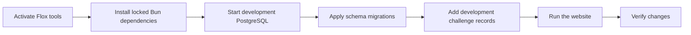

# Local development

This guide is for changing the website itself. To solve a coding challenge, you only need the tools for your chosen language; start with [Getting started](getting-started.md) instead.

The development environment supplies Node.js, Bun, Git, and PostgreSQL on macOS and Linux. Flox provides those tools consistently, while Bun installs JavaScript dependencies and runs the project's scripts. Next.js and Prisma use Node.js for runtime compatibility.

## Install the project

Install [Flox](https://flox.dev/docs/install-flox/), then clone the repository and activate its committed environment:

```bash
git clone https://github.com/youbuildit/youbuildit.dev.git
cd youbuildit.dev
flox activate
bun install --frozen-lockfile
cp .env.example .env.local
```

Run the following commands from that activated shell. Installation generates the Prisma client and configures the Git hooks. It does not require a running database, create tables, or import challenge content.

The committed Flox manifest and lockfile define the tool environment. The Bun lockfile defines application dependencies. Keep both kinds of lockfiles under version control so another contributor can reproduce your setup.

## Create a local database

Use a development database that you can change without affecting readers. The schema requires PostgreSQL; a SQLite file URL will not work.

If you already have a PostgreSQL server, create a separate database there and use its connection URL. Otherwise, the tools supplied by Flox can start a local development cluster:

```bash
YBI_PG_DATA="$(mktemp -d "${TMPDIR:-/tmp}/youbuildit-postgres.XXXXXX")"
initdb -D "$YBI_PG_DATA" --username=postgres --auth=trust
pg_ctl -D "$YBI_PG_DATA" -o "-h 127.0.0.1 -p 55432" \
  -l "$YBI_PG_DATA/server.log" start
createdb -h 127.0.0.1 -p 55432 -U postgres youbuildit_dev
export PRISMA_DATABASE_URL=postgresql://postgres@127.0.0.1:55432/youbuildit_dev
bun run db:migrate
```

This example binds PostgreSQL to the loopback interface and uses trust authentication for local development. It is not a production database configuration. Save the printed data-directory location if you want to restart the cluster in another terminal. If port `55432` is occupied, choose another port consistently in the server and connection commands.

Put the same development URL in `.env.local` for future application sessions. Prisma's CLI reads `PRISMA_DATABASE_URL` from the process environment, so keep the `export` when running migrations. Setting a value only in `.env.local` is not enough for every CLI command.



## Understand an empty database

Migrations create the schema; they do not copy the public catalog. A successful connection to a new database can therefore show an empty challenge library. The homepage and documentation render independently of challenge records, but featured challenge links need the corresponding records to exist.

For content-related development, use your own development dataset. You can inspect or create a local record with `bunx prisma studio` while the development URL is exported. A basic `Challenge` needs a unique `slug`, a title and summary, a difficulty, category, skills, estimated time, and Markdown content. Set `published` to true to make it visible; leave `hasSolution` false unless you also provide solution files.

Do not use `scripts/seed-browser.ts` as a production importer. It intentionally accepts only a database named `youbuildit_test` and creates a clearly labeled automation fixture. The public catalog and your local test fixture are different datasets.

## Start the website

```bash
bun run dev --hostname 127.0.0.1 --port 4317
```

Open `http://127.0.0.1:4317`. Check the homepage, documentation, and challenge library. If the library fails, inspect the terminal output and confirm the database URL and server status before changing application code.

Alternatively, after installing dependencies and configuring `.env.local`, use the Flox web service:

```bash
flox services start web
flox services status
flox services stop web
```

Use either the foreground command or the service on port `4317`, not both at once. The `web` service runs Next.js; it does not create or manage the PostgreSQL cluster in the earlier example.

## Configure optional features

| Variable                        | Purpose                                                                   |
| ------------------------------- | ------------------------------------------------------------------------- |
| `PRISMA_DATABASE_URL`           | Required for challenge data; direct PostgreSQL or a Prisma Accelerate URL |
| `NEXT_PUBLIC_BASE_URL`          | Canonical site origin used for metadata and links                         |
| `GITHUB_TOKEN`                  | Optional token for GitHub commit metadata                                 |
| `NEXT_PUBLIC_CODE_REPO_URL`     | Optional source-code repository link                                      |
| `NEXT_PUBLIC_FEEDBACK_REPO_URL` | Optional feedback repository link                                         |

Direct URLs begin with `postgresql://` or `postgres://`. Accelerate URLs use the supported Prisma connection format, such as `prisma+postgres://`. The application chooses the connection implementation from the URL. See [Architecture](architecture.md) for how this is wired.

Never commit `.env.local` or an actual credential. Use `.env.example` to describe a new variable with a placeholder. Public-prefixed variables can be included in browser code; do not put secrets in them.

## Check and preview production behavior

```bash
bun run check
bun run build
bun run start --hostname 127.0.0.1 --port 4317
```

Stop the development server before starting the production preview on the same port. `check` runs formatting, lint, TypeScript, Markdown and Mermaid validation, the source line budget, and unit tests. `verify` combines those checks with a production build.

Documentation content is read from `docs/` during page generation. Code fences receive syntax highlighting in the generated page, and Mermaid fences render as diagrams with an expandable source fallback. Rebuild the production preview after changing Markdown; a running production server does not behave like the development server's live reload.

For browser checks, run `bunx playwright install chromium` once inside Flox, then `bun run verify:browser`. That command creates a separate temporary PostgreSQL cluster, applies migrations, verifies schema consistency, seeds the test fixture, builds, and runs Playwright. It stops the temporary database afterward. See [Contributing](contributing.md) for the full workflow.

## Stop local services

Stop the web command with Ctrl+C, or use `flox services stop web` if you started the Flox service. Stop the example PostgreSQL cluster separately:

```bash
pg_ctl -D "$YBI_PG_DATA" -m fast stop
```

Keep the data directory if you want to reuse its records. Starting or stopping the web server does not delete the database. If you lose the terminal variable, use the data-directory path you saved earlier.

Without Flox, install the Node and Bun versions declared in `package.json` and a compatible PostgreSQL server, then use the same application commands. Record that difference when reporting environment-specific problems.
