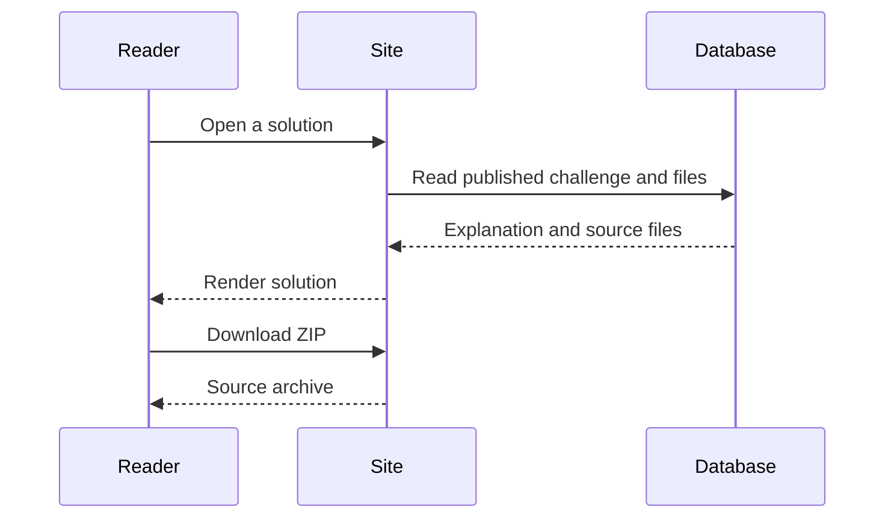
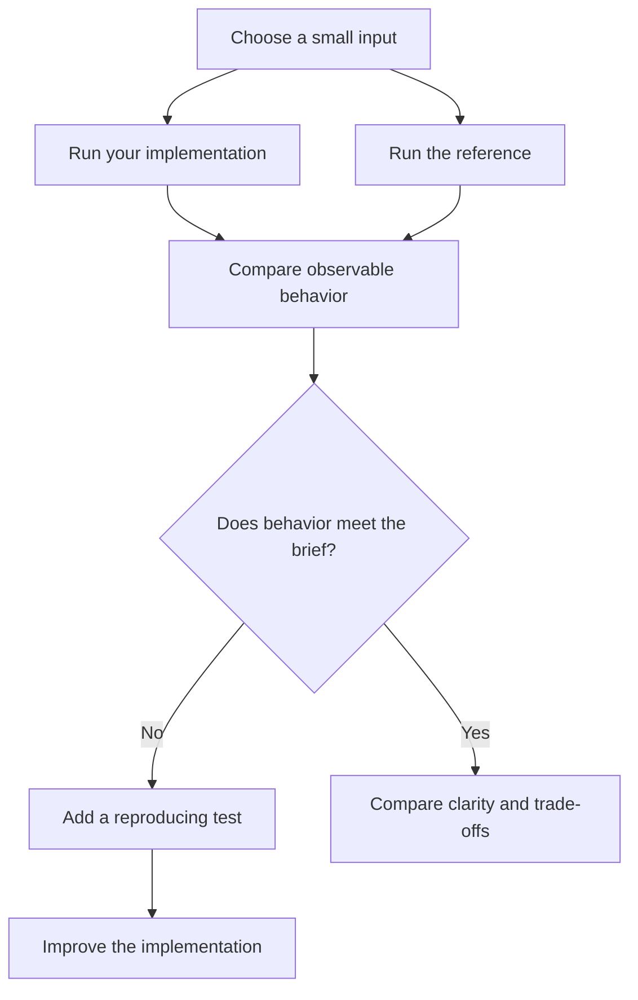

# Solutions

Solutions are available on challenges that have an attached implementation. A challenge without one is still a complete project brief; availability varies across the library.

## Read a solution

Open a challenge and use its solution controls. Read the explanation and source files alongside your implementation. All published solutions are accessible without signing in.

Ask what each approach optimizes for: clarity, speed, memory, or ease of change. A different implementation can be correct even when it looks nothing like yours.

## Download the source

Use the download action when provided. It returns a ZIP archive containing the available solution files. Extract the archive into a new directory, review the code, and follow any included setup instructions before running it.



## When a solution is unavailable

A missing solution can mean the challenge has no reference implementation yet. If a previously available solution fails to load, refresh and retry. If it continues, report the challenge URL and the error in [GitHub issues](https://github.com/youbuildit/youbuildit.dev/issues). Do not include credentials or private code.

## Navigate the file preview

Use **Show Preview** to open the file list, then select a file to read it. The selected file has a green border. Each entry shows its filename, file type, and line count; nested files also show their directory so that files with the same name remain distinguishable.

README files appear first, followed by source files, test files, and other supporting files. A README can be viewed as rendered Markdown or raw code. Source files use syntax highlighting based on their filename. A file preview is a reading tool: it does not run the implementation in your browser.

| File type     | What to look for                                              |
| ------------- | ------------------------------------------------------------- |
| README        | Setup commands, supported behavior, limitations, and examples |
| Source        | The entry point, core algorithms, and error handling          |
| Test          | Expected behavior and representative edge cases               |
| Configuration | Dependencies, runtime requirements, and tool settings         |
| Fixture       | Inputs used by tests or demonstrations                        |

Start with the README rather than the largest source file. Then locate the entry point and follow one input through the program. Tests often explain an edge case more clearly than an implementation comment.

## Compare behavior before structure

Run your implementation and the reference on the same small inputs. If their outputs differ, consult the brief before deciding which is correct. Some projects allow multiple valid interfaces; others ask for compatibility with an existing protocol or tool.

For a text-processing tool, a comparison table might look like this:

| Input               | Your result         | Reference result    | What to investigate             |
| ------------------- | ------------------- | ------------------- | ------------------------------- |
| Empty string        | Zero words          | Zero words          | Agreement on the empty case     |
| Repeated whitespace | Extra words         | Expected word count | How tokens are separated        |
| Missing file        | Unhandled exception | Clear error         | Error reporting and exit status |

These are illustrative cases, not results from a particular published solution. Keep your actual observations in your own notes or tests.



## Run downloaded code in its own environment

After downloading, list the archive contents and extract them into a new directory:

```bash
unzip -l solution.zip
mkdir reference-solution
unzip solution.zip -d reference-solution
cd reference-solution
```

Read the included README and dependency files before choosing a runtime. A Python reference, for example, might use a virtual environment; a JavaScript reference might specify its own package manager. The platform's Bun setup is not a universal setup command for all challenge solutions.

Do not infer correctness from a displayed coverage percentage alone. Some metadata can be estimated when recorded measurements are absent. Run the tests locally, understand their assertions, and add cases for behavior they do not cover.

## Keep the learning in your own project

After comparing approaches, choose one improvement you can explain: a clearer function boundary, a missing edge-case test, or a better failure message. Implement it in your project and rerun your checks. You do not need to rewrite your work to match the reference's structure.

If the reference itself appears wrong, report a small reproducible example with the challenge URL, expected behavior from the brief, and observed result. See [Contributing](contributing.md) for a useful issue-report format.
