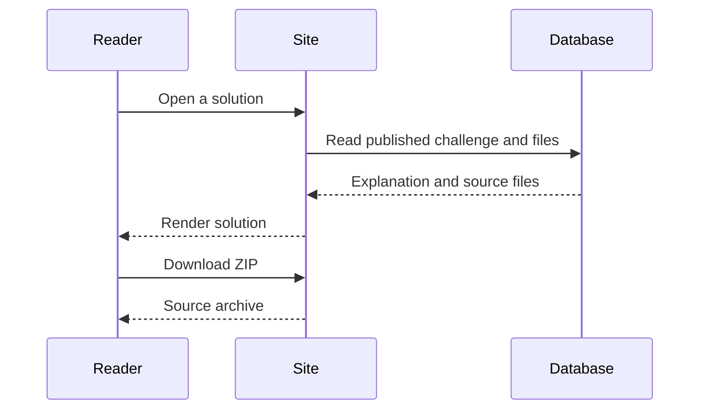

# Solutions

Solutions are available on challenges that have an attached implementation. A challenge without one is still a complete project brief; availability varies across the library.

## Read a solution

Open a challenge and use its solution controls. Read the explanation and source files alongside your implementation. All published solutions are accessible without signing in.

Ask what each approach optimizes for: clarity, speed, memory, or ease of change. A different implementation can be correct even when it looks nothing like yours.

## Download the source

Use the download action when provided. It returns a ZIP archive containing the available solution files. Extract the archive into a new directory, review the code, and follow any included setup instructions before running it.

## When a solution is unavailable

A missing solution can mean the challenge has no reference implementation yet. If a previously available solution fails to load, refresh and retry. If it continues, report the challenge URL and the error in [GitHub issues](https://github.com/youbuildit/youbuildit.dev/issues). Do not include credentials or private code.
