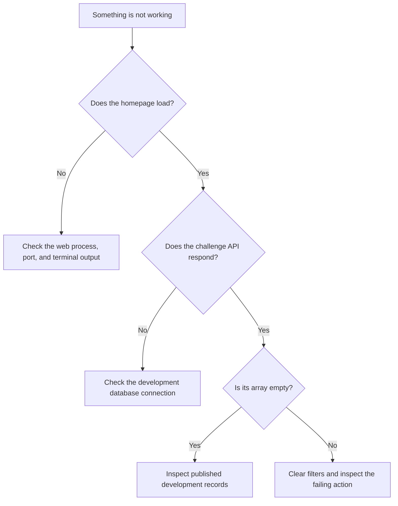

# Troubleshooting

## No challenges match

Clear the search and filters. A narrow combination can return no results even when the library has content. If the page reports a loading error, retry once and check your connection.

## A solution will not download

Not every challenge includes solution files. Check whether the challenge offers a download, then retry from its page. A persistent failure should be reported with the challenge URL and HTTP status, without private credentials.

## The local database is unavailable

Verify that `PRISMA_DATABASE_URL` is set to a development PostgreSQL or Prisma Accelerate URL. Direct PostgreSQL connections use the Prisma PostgreSQL driver adapter; Accelerate connections use the Accelerate extension. SQLite paths are not supported.

An empty development database has no challenge records. Migrations create the schema, not a copy of production content. Homepage and documentation do not require challenge data, but browsing challenges does.

## Dependencies or generated types are stale

Activate Flox and install from the lockfile again:

```bash
flox activate
bun install --frozen-lockfile
bun run typecheck
```

The install step generates Prisma types. If the dependency manifest and lockfile disagree, update the lockfile with `bun install` and commit both files after review.

## A commit is blocked

Read the failing check, fix the underlying issue, and rerun `bun run check`. Use `bun run format` for formatting changes. Mermaid errors usually indicate an invalid diagram node or unsupported syntax. Line-budget errors name the file or total that exceeded its limit.

## Flox cannot resolve packages

Check network access and the installed Flox version. The committed lockfile avoids routine re-resolution. As a temporary fallback, use the versions in `package.json`; report that the Flox environment was not verified rather than changing its pins silently.

## Identify which layer is failing

Start with the page or action that fails, rather than reinstalling everything. A rendered homepage with an empty library is a different problem from a server that will not start.



Check the local API without the browser interface:

```bash
curl --include http://127.0.0.1:4317/api/challenges
```

A `200` response containing `[]` means the request succeeded but there are no published challenge summaries to show. A `500` points to a server-side problem; inspect your local terminal for the underlying error. A connection-refused message usually means no process is listening at that address and port.

## Search or selection feels stuck

In quick search, focus the input before using arrow keys. The green row is the result that Enter will open. Press Escape to close the dialog, then reopen it with the navigation button or Cmd+K/Ctrl+K.

If an old tab behaves differently after an update, reload it so its JavaScript and styles match the current server. If the issue remains, report the browser, viewport size, whether you used the pointer or keyboard, and the sequence that reproduced it. The background page should not scroll while the search dialog is open.

## A local page contains only the browser-test fixture

The browser verification script builds against an isolated test database. Its fixture is labeled as a test challenge and is not the full public catalog. If you reuse that build for a manual preview, some generated pages may still reflect the test dataset.

Stop the preview, configure your intended development database, rebuild, and restart. Rebuilding changes application output; it does not copy challenge records into your database. See [Local development](local-development.md) for the difference between schema setup and content setup.

## A diagram or code example is displayed incorrectly

Use a fenced block with a language name, such as `bash`, `python`, `javascript`, `json`, or `mermaid`. Plain code fences without a language remain unhighlighted. Mermaid diagrams have their own renderer rather than ordinary code highlighting.

```bash
bun run docs:check
bun run build
```

The documentation check reports invalid Mermaid syntax and broken local links. In a production preview, rebuild after editing Markdown. If a diagram cannot render in the browser, expand its source to read the workflow and include that source in a bug report.

## A port is already in use

Do not stop an unrelated process just to free a port. Check whether you already started the web service through Flox or in another terminal. Stop the instance you own, or run your development server on a different port:

```bash
bun run dev --hostname 127.0.0.1 --port 4319
```

The browser verification command uses its own configured web-server port and a temporary database port. Changing your interactive preview port does not change those test settings.

## Write a useful bug report

Include the route, expected result, actual result, and the shortest steps that reproduce it. For local failures, add your operating system, whether Flox was active, the command that failed, and a small sanitized error excerpt.

Screenshots help with layout issues, but include text describing what is wrong so the report can be searched and read without the image. Remove credentials, database URLs containing passwords, and private implementation files before sharing logs.
